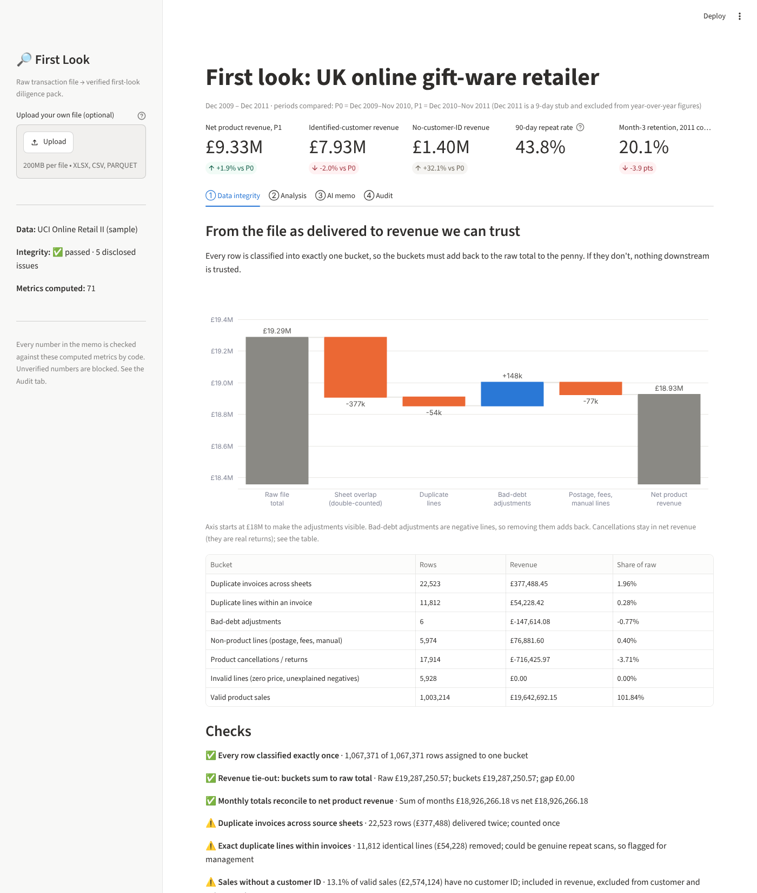
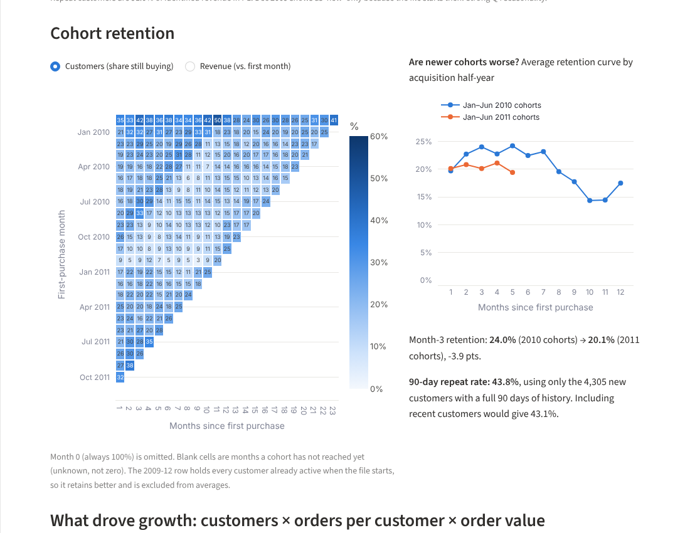
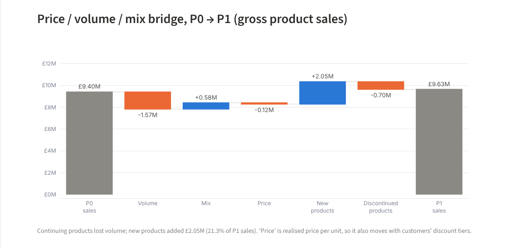
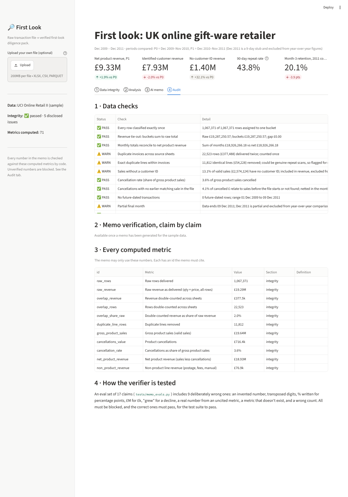

# First Look

**Turns a raw transaction file into a verified first-look diligence pack in minutes.**

**[Live demo](LIVE_APP_URL)** · built on 1M+ real transactions from the public UCI *Online Retail II* dataset



---

## What it does

Drop in a company's raw transaction file. One run produces:

| | |
|---|---|
| **① Data integrity report** | Every row classified into exactly one bucket (sale, cancellation, duplicate, non-product, …) and **tied out to the raw total to the penny**. Issues are disclosed, not silently dropped. |
| **② Consumer analysis** | Cohort retention triangles (customers and revenue), censoring-adjusted 90-day repeat rate, new vs. repeat revenue, driver tree (customers × orders × AOV), price/volume/mix bridge, customer and product concentration. |
| **③ AI-written memo, verified by code** | Claude writes the first-look memo from the computed metrics only. **Code checks every number** against those metrics; anything unverified is blocked. |
| **④ Audit tab** | Every check, every memo claim (verified or blocked, and why), and every computed metric, so an investor can trust the output. |

## What it found in the sample data

On a UK online gift-ware retailer (Dec 2009 – Dec 2011):

- **The file double-counts £377k.** The two yearly sheets overlap for Dec 1–9, 2010; 22,523 rows appear in both. Stacking them naively overstates revenue.
- **Headline growth isn't customer growth.** Net product revenue grew **1.9%**, but revenue from identified customers **fell 2.0%**. All the growth came from sales with no customer ID (**+32.1%**). That's the first question for management.
- **Newer cohorts retain worse.** Month-3 retention fell from **24.0%** (H1 2010 cohorts) to **20.1%** (H1 2011 cohorts), **−3.9 pts**.
- **Growth relies on new products.** Continuing products lost **£1.57M** of volume; products new in the year added **£2.05M** (**21.3%** of sales).
- **Customer concentration is high.** The top 1% of customers are **30.7%** of sales.





## Design decisions

**1. Code verifies the AI, not the other way round.** LLMs write fluent summaries and occasionally wrong numbers, and a wrong number in an IC memo is worse than no memo. So:

- Claude sees **only the computed metric registry** (71 metrics, each with an id), never raw data.
- Output is **structured**: every claim must cite the metric ids it uses.
- `verify.py` extracts every number and checks it against the cited metrics after normal rounding. It blocks invented numbers, wrong units (% vs. percentage points, £k vs. £M), wrong direction ("grew" on a decline), and real numbers taken from a metric the claim didn't cite.
- Blocked claims go back to Claude with the exact errors for one retry. Whatever still fails is **removed** and listed on the Audit tab.
- **Eval set** (`tests/memo_evals.py`): 24 claims, 11 deliberately wrong. The suite only passes if all 11 are caught and all 13 correct ones pass.
- **Tuned on a real run.** The first live run blocked 5 claims, but review showed 4 of them were *correct* claims the verifier misread: "fell from 24.0% to 20.1%" (a direction word checked against a level, not a change), a direction word carried across clauses, an explicit minus sign overridden by the word "growth", and a date read as a figure. I fixed each one and added all of them to the eval set as must-pass cases. A verifier that blocks correct claims pushes the model into stilted wording, so false positives matter as much as misses.

This is the same "AI proposes, code verifies" pattern I used in [LionMeet](https://priyanka-data-storybook.lovable.app), applied to diligence.

**2. Retention is adjusted for customers who haven't had time to repeat.** A customer acquired last month can't have a 90-day repeat yet. Counting them as non-repeaters understates retention and makes recent cohorts look worse than they are. The 90-day repeat rate uses only the 4,305 new customers with a full 90 days of history, and the triangles blank out (rather than zero) months a cohort hasn't reached.

**3. The first cohort is left-censored.** The file starts in Dec 2009, so the "Dec 2009 cohort" is every existing customer, not new ones. It retains far better than real cohorts, so it's shown but excluded from averages.

**4. Integrity before analysis, enforced by construction.** Every row lands in exactly one bucket, so the buckets must sum to the raw total. If the tie-out fails, the run is marked FAILED. Analysis identities are also checked: the driver tree multiplies back to revenue, and the PVM bridge closes to £0.00.

**5. Reusable.** Thresholds and periods live in `config.py`, not the code. A new data room means a new config, not a rewrite.

## Limitations, stated honestly

- **This is mostly a wholesale business, not a consumer one.** The median order is about £300 and most buyers are trade accounts (gift shops). True end consumers can't be identified. I segment by median order value (≥ £500 = large account) as a proxy, but the cohort logic is what matters: it transfers directly to a DTC brand.
- **13% of sales have no customer ID**, so customer-level metrics cover 87% of revenue. Those sales are in revenue, but out of cohorts.
- **Duplicate lines within an invoice (11,812) are removed** but could be genuine repeat scans. In a real deal, that's a question for management.
- **"Price" in the bridge is realised price per unit**, so it also moves when customers shift between discount tiers.
- **The verifier checks numbers, not reasoning.** It guarantees every figure is right and correctly attributed; it can't guarantee the interpretation is right. Example from a real run: the memo said revenue retention above customer retention "suggests surviving customers spend more". It may instead mean bigger buyers are the ones who stay (selection). Every number was correct; the inference wasn't. That caveat now lives in the metric's definition, which the model reads, and the analyst still owns the memo.
- **Observational data can't prove causation.** For example, whether the fall in retention was caused by anything specific needs a test or a natural experiment.

## What I'd do with a real data room

1. **Entity resolution across channels.** Match DTC, marketplace and retail-loyalty customers to one ID before any cohort work. Duplicates make retention look worse and new-customer counts look better.
2. **Join third-party data.** Card-panel and scanner data to check management's growth story and benchmark against the category.
3. **Rebuild LTV per cohort on contribution margin**, with CAC by channel, instead of revenue-based LTV.
4. **Causal tests for the questions that matter.** A geographic holdout or difference-in-differences for "did the price increase cost volume?"
5. **Make it a deal-team tool**: Excel and IC-deck export, a config per deal, and a growing library of checks from past deals.



## Run it

```bash
pip install -r requirements.txt
export PYTHONPATH=src                     # the package lives in src/
python -m firstlook.pipeline              # integrity + analysis → outputs/
pytest                                    # 37 tests incl. the memo eval set
export ANTHROPIC_API_KEY=...              # optional, never committed
python -m firstlook.memo                  # writes outputs/memo.json (verified)
streamlit run app.py
```

The public app shows a **pre-generated** memo, so it never calls the API and can't fail during a demo. For the sample data it also reads the pipeline's saved outputs rather than recomputing a million rows, which keeps it fast and within free-hosting memory. A test checks the saved outputs equal a fresh run. Uploaded files get the full live analysis.

**Databricks:** `databricks/first_look_notebook.py` runs the same pipeline on Databricks, writes raw → clean → analysis Delta tables, and re-computes the cohort triangle in Spark SQL (`databricks/cohort_retention.sql`). It matches the Python result on all 300 cohort cells.

## Repo

```
src/firstlook/
  load.py        raw file → standard schema (xlsx / csv / parquet)
  integrity.py   classify every row, tie out, checks
  prep.py        analysis-ready lines: cohort, segment, month
  cohorts.py     retention triangles, censoring-adjusted repeat rate
  drivers.py     driver tree, new vs repeat, segments, concentration, PVM bridge
  metrics.py     the metric registry: the only numbers the memo may use
  memo.py        Claude memo generator (structured output + retry)
  verify.py      number-level verification of the memo
  pipeline.py    one call: raw file in, results out
tests/           pipeline tests, memo eval set, retry tests
databricks/      notebook + Spark SQL cross-check
app.py           Streamlit app
```

Built by Priyanka Nair with Claude Code. Data: Chen, D. (2019). *Online Retail II*. UCI Machine Learning Repository, CC BY 4.0.
